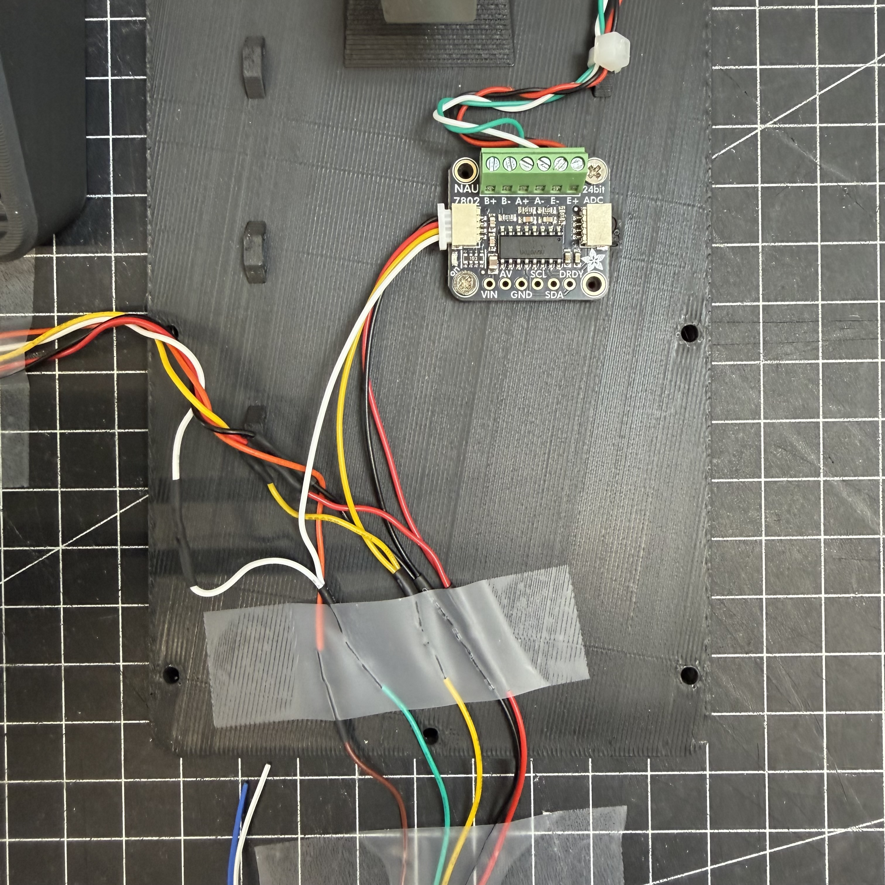
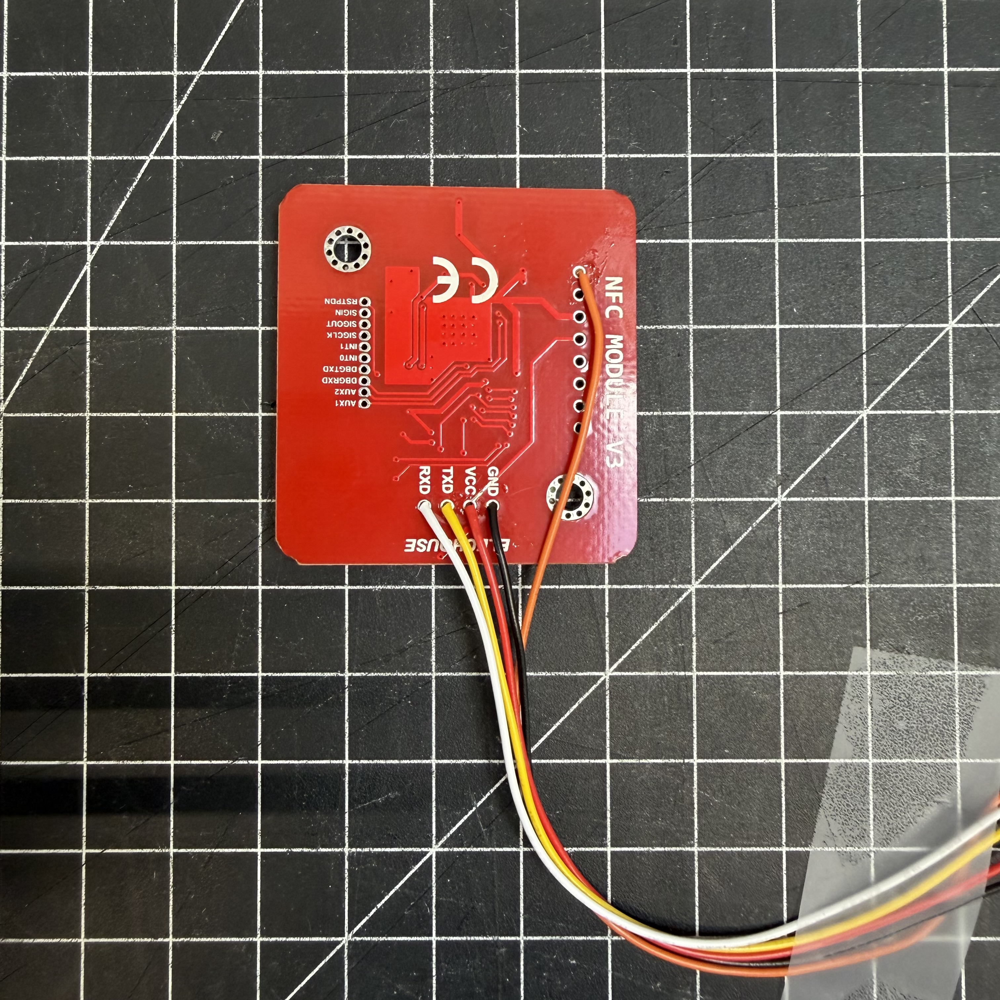
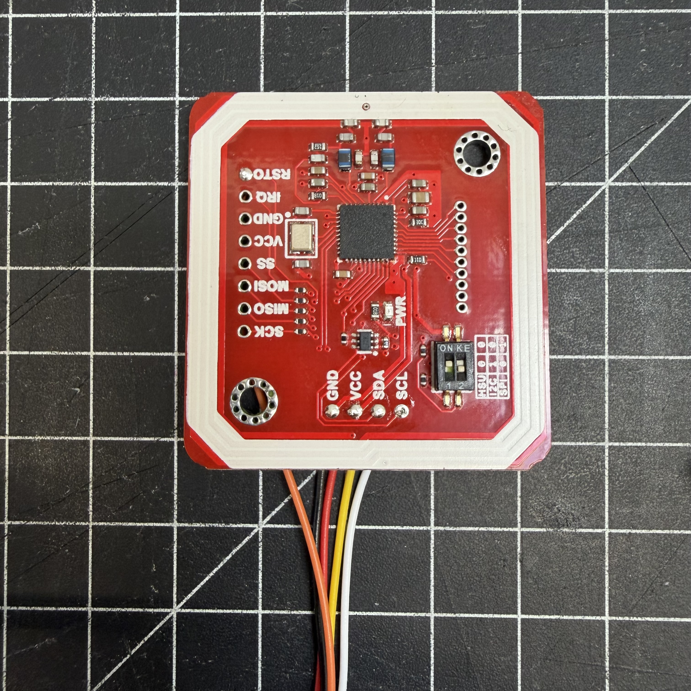
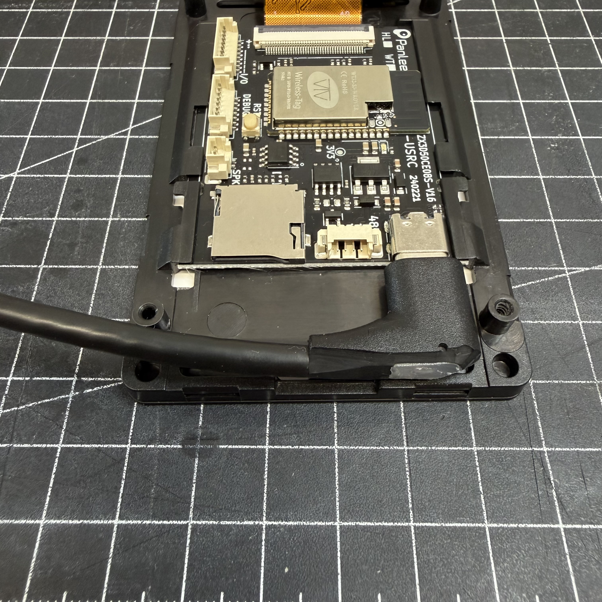
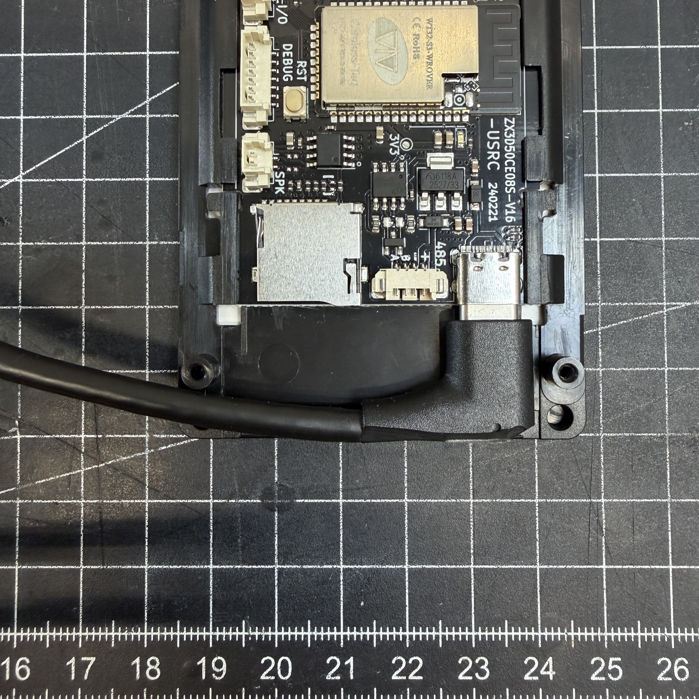
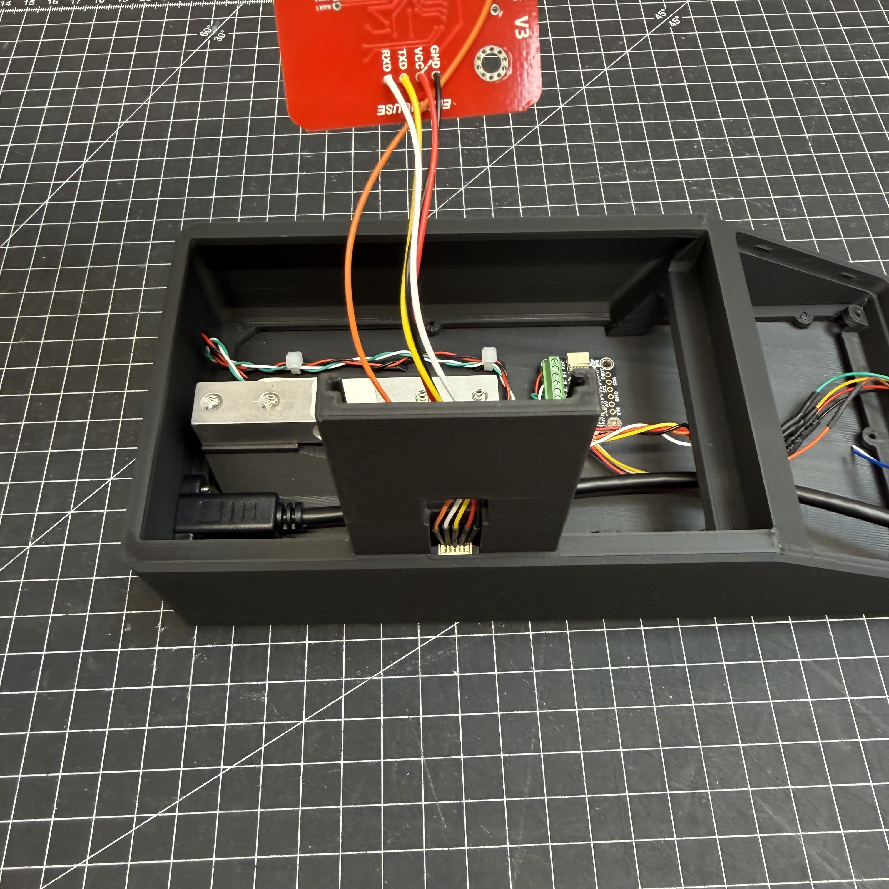

# SpoolmanScale – Build Guide

This guide covers everything you need to physically build a SpoolmanScale: parts, wiring, assembly, and calibration.

For the project overview, features, and flashing instructions, see the [README](README.md).

> ⚠️ This is a beta build guide. If something is unclear or doesn't fit your hardware batch, please report it on [MakerWorld](https://makerworld.com/@FormFollowsF) or in the [Discord](https://discord.gg/xadskCrPFu).

---

## Parts List

### Electronics

| Component | Model | Link |
|---|---|---|
| MCU + Display | WT32-SC01 Plus (ESP32-S3, 480×320, ST7796) | [AliExpress](https://a.aliexpress.com/_Ey1VKfI) |
| Debug Board (recommended) | ZXACC-ESPDB | [AliExpress](https://a.aliexpress.com/_Eu5Y0Ug) |
| NFC Reader | PN532 | [AliExpress](https://a.aliexpress.com/_ExScN8M) |
| Scale ADC | NAU7802 or HX711 module | [NAU7802](https://a.aliexpress.com/_EvlFNj2) |
| HX711 regulator (HX711 builds only) | AMS1117-3.3 V regulator module (5 V → 3.3 V) | — |
| Load Cell | YZC-133 2 kg beam cell (5 kg works too) | [AliExpress](https://a.aliexpress.com/_EuhhVF2) |
| Connector Cables | STEMMA QT / JST cables | [AliExpress](https://a.aliexpress.com/_Ezjg6fQ) |
| Connector Cables (recommended) | Micro JST 1.0 SH 5-pin – easier assembly | [Amazon](https://amzn.eu/d/0aKJ4Va9) |
| USB-C Panel Mount 90° | 30 cm, full USB-C PD + data support | [AliExpress](https://a.aliexpress.com/_EjQ6sma) |

### Additional Materials

- Thin stranded wire in 5 different colors (black, red, yellow, white, green – ~30–40 cm each)
- 2× M5×25 socket head screws
- 2× M4×15 socket head screws
- 9× M2.5×5 self-tapping screws
- 2–4× M2×4.4 self-tapping screws ([example](https://a.aliexpress.com/_EyCD3rS))

Self-tapping screws are recommended, but standard machine screws (M2.5×5, M2×4) will likely work as well.

---

## 3D Files

The printable enclosure is available on MakerWorld:
👉 [makerworld.com/@FormFollowsF](https://makerworld.com/de/models/2713675-spoolmanscale#profileId-3005075)

All parts fit on 3 print plates (currently distributed across 4). If you can print TPU, use it for the feet – they grip better. Otherwise, self-adhesive silicone feet work just as well.

> If the enclosure is too tight or too loose for your display, please report it – display dimensions can vary slightly between batches.

---

## Assembly Steps

### Step 1 – Flash the board first

Before assembling anything, flash the firmware to the bare board via the [Web Flasher](https://niko11111.github.io/SpoolmanScale), selecting the ADC you are going to fit (NAU7802 or HX711). This confirms the board is working before you start wiring.

### Step 2 – Wire components one at a time

Connect components one at a time – NFC reader first, then the scale ADC and load cell – and verify each one works before moving on. Much easier to debug at this stage than inside a fully assembled enclosure.

See the wiring tables below for all connections.

### Step 3 – Assemble & close up

Wire everything up, do a final check that all components are working, then press the display into the enclosure. It should sit snugly without screws. If you want extra security, it can be fastened from the back.

### Step 4 – Calibrate the scale

Go to **Settings → Scale → Calibration**.

1. Tare the scale with nothing on it
2. Place an object with a known weight – ideally ~1000 g (a full filament spool verified on a kitchen scale works well)
3. Enter the exact weight in grams and save

The more precise your reference weight, the more accurate your results.

---

## Wiring

All components connect to the **I/O connector** on the WT32-SC01 Plus using the included 7-pin cable. The I/O socket has 8 pins - plug the 7-pin cable in flush to the left.

There are two firmware builds, one per scale ADC. **Choose the ADC that is physically fitted in the Web Flasher** before installing: NAU7802 firmware cannot talk to an HX711 and vice versa. Calibration is stored on the scale and is reset automatically when a different ADC build is installed, so tare and calibrate again afterwards.

With the NAU7802, the PN532 and ADC share the I2C bus (SDA/SCL) and are wired in parallel. **Do not daisy-chain them via the NAU7802's STEMMA QT passthrough** – that port only supplies 3.3 V and the PN532 requires 5 V.

With the HX711, only the PN532 is on the I2C bus. The HX711 is not an I2C device: it uses its own clock (`SCK`) and data (`DOUT`) lines on connector pins 5 and 6.

### WT32-SC01 Plus I/O Connector

| Pin | Color | Signal | NAU7802 build | HX711 build |
|---|---|---|---|---|
| 1 | Red | 5 V | PN532 VCC + NAU7802 VIN | PN532 VCC + 3.3 V regulator **input** |
| 2 | Black | GND | PN532 GND + NAU7802 GND | PN532 GND + regulator GND + HX711 GND |
| 3 | Yellow | GPIO10 (SDA) | PN532 SDA + NAU7802 SDA | PN532 SDA |
| 4 | Green | GPIO11 (SCL) | PN532 SCL + NAU7802 SCL | PN532 SCL |
| 5 | Blue | GPIO12 | unused | HX711 `SCK` (also labelled `CLK` / `PD_SCK`) |
| 6 | White | GPIO13 | unused | HX711 `DOUT` (also labelled `DT` / `DAT`) |
| 7 | Brown | GPIO14 | PN532 RST | PN532 RST |
| 8 | – | GPIO21 | not connected (7-pin cable sits flush left) | not connected |

### HX711 wiring

The I/O connector has no 3.3 V pin, and the ESP32-S3 GPIOs are **not 5 V tolerant**. A common HX711 module powered from 5 V drives `DOUT` at 5 V, which can damage GPIO13. Power the HX711 from 3.3 V through a small **AMS1117-3.3 regulator module**:

| From | To |
|---|---|
| I/O pin 1 (5 V, red) | AMS1117 `VIN` / `IN` |
| I/O pin 2 (GND, black) | AMS1117 `GND` **and** HX711 `GND` |
| AMS1117 `VOUT` / `3.3V` | HX711 `VCC` |
| I/O pin 5 (GPIO12, blue) | HX711 `SCK` |
| I/O pin 6 (GPIO13, white) | HX711 `DOUT` |

- **Measure the regulator output (≈3.3 V) with a multimeter before connecting the HX711.** Never connect the regulator's 3.3 V output back to pin 1.
- Modules with separate supply pins (e.g. SparkFun: `VDD` for logic, `VCC` for the analog side) need `VDD` on 3.3 V. `VCC` may then go to either 3.3 V or 5 V.
- Leave the module's `RATE` pin/jumper at its default (10 samples/s, `RATE` to GND). 80 samples/s works too, but is noisier.
- Only channel A is used (gain 128). Leave `B+`/`B−` unconnected.
- The PN532 wiring is the same in both builds.

### Load Cell → HX711

| Load Cell wire | HX711 terminal |
|---|---|
| Red | E+ (excitation +) |
| Black | E− (excitation −) |
| White | A+ (signal +) |
| Green | A− (signal −) |

> If the weight goes down when you load the scale, swap A+ and A−. Then tare and calibrate again.

### PN532 – Soldering & Assembly

The PN532 has no connector - wires must be soldered directly. **Always solder from the back of the PCB** - there is not enough clearance on the front once it's mounted.

**Recommended assembly order:**

1. Solder all other components first (NAU7802 or HX711, load cell, WT32 breakout cable) with the enclosure open
2. Leave the PN532 wires loose and long enough to work with
3. Feed the loose wires up through the PN532 mount opening from below
4. Solder the wires to the back of the PN532 PCB
5. Slide the PN532 into its mount and pull the excess cable back down into the enclosure
6. Route and secure cables so they don't press against the weighing platform

If you use a 5-pin JST SH 1.0mm connector on the PN532 pigtail, the mount opening is just large enough to pass the connector through - meaning you can do all soldering outside the enclosure and simply plug it in during final assembly.

### PN532 – Cable Pinout (JST SH 1.0mm 5-pin, 3rd party colors)

| Pin | Color (3rd party) | Signal | WT32 Cable |
|---|---|---|---|
| 1 | Black | GND | Pin 2 (Black) |
| 2 | Red | 5 V | Pin 1 (Red) |
| 3 | Yellow | SDA | Pin 3 (Yellow) |
| 4 | White | SCL | Pin 4 (Green) |
| 5 | Orange | RST | Pin 7 (Brown) |

### NAU7802 – STEMMA QT Connector (JST SH 1.0mm 4-pin)

Soldering directly to the labeled pads (VIN, GND, SDA, SCL) on the NAU7802 is the safest option. If you prefer the STEMMA QT connector, note that the pin order of 3rd-party JST SH 1.0mm cables does **not** match the WT32 cable - you will need to re-pin or swap wires:

| STEMMA QT Pin | Color (3rd party) | Signal | WT32 Cable |
|---|---|---|---|
| 1 | Black | GND | Pin 2 (Black) |
| 2 | Red | 5 V | Pin 1 (Red) |
| 3 | Yellow | SDA | Pin 3 (Yellow) |
| 4 | White | SCL | Pin 4 (Green) |

### Load Cell → NAU7802

| Load Cell wire | NAU7802 terminal |
|---|---|
| Red | E+ (excitation +) |
| Black | E− (excitation −) |
| White | A+ (signal +) |
| Green | A− (signal −) |

> If the scale shows negative values, swap A+ and A−.

### USB-C Panel Mount

The USB-C panel mount extension needs to be trimmed before installation. Using a utility knife, carefully shorten the connector housing little by little until it no longer protrudes beyond the display edge. Take your time – small cuts at a time. Once flush, it will fit cleanly into the enclosure.

---

## Assembly Photos

 
 
 
 

