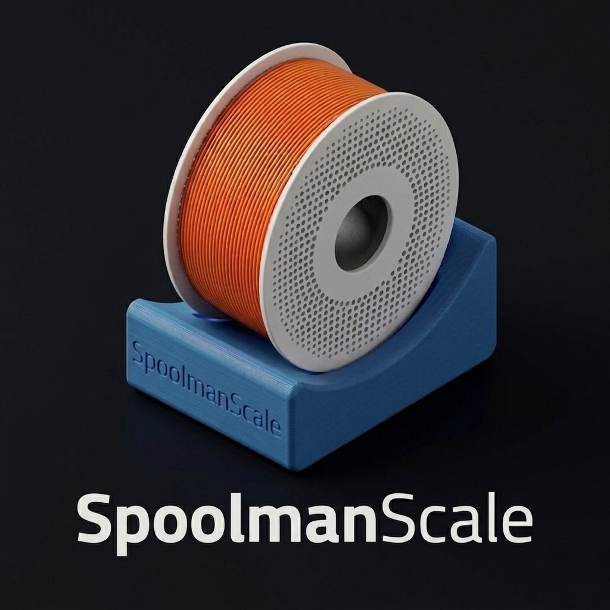
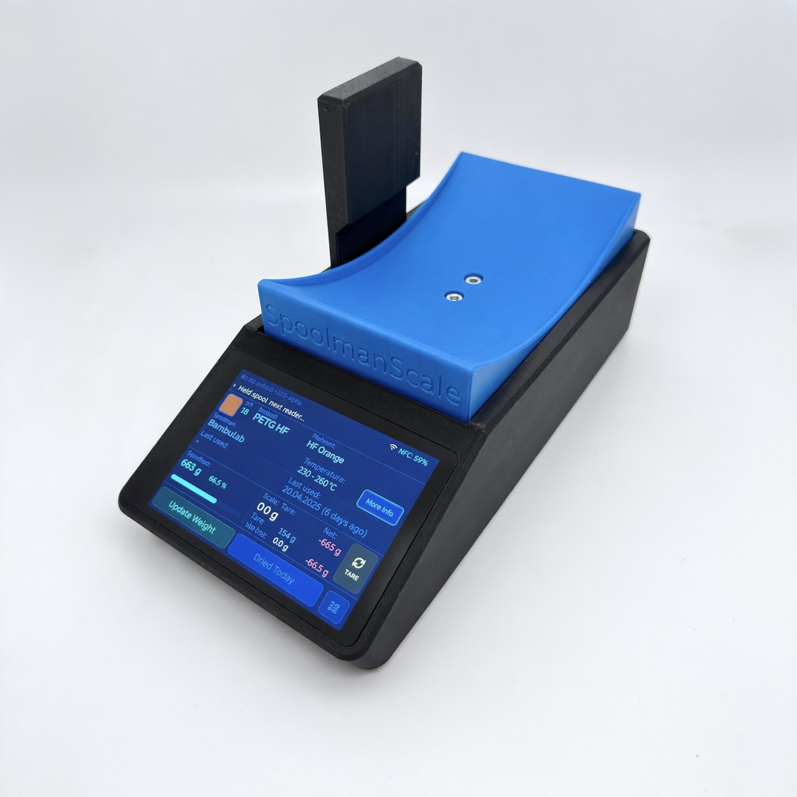
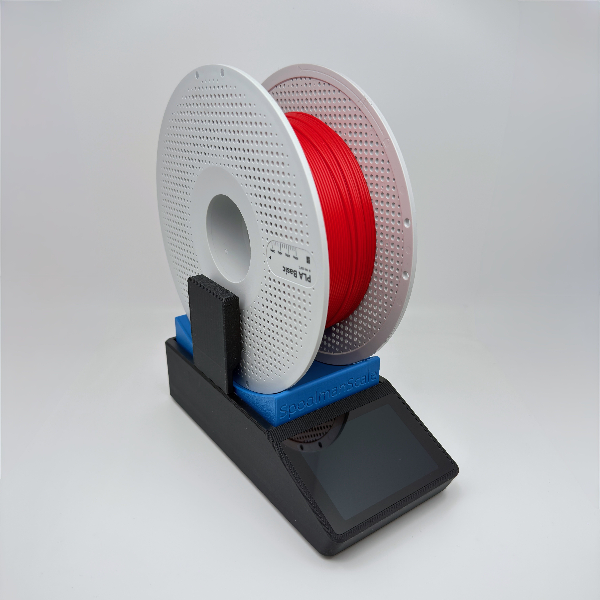

<picture>
  <source media="(prefers-color-scheme: light)" srcset="images/logo_1.jpeg">
  <source media="(prefers-color-scheme: dark)" srcset="images/logo_2.jpeg">
  
</picture>

# SpoolmanScale

### *One Scale to rule them all.*

**SpoolmanScale** is an ESP32 filament scale with an NFC reader, a touchscreen and open-source firmware. Place a spool on it: the scale reads its tag, pulls the spool from your filament manager and lets you update the weight, log a drying date, set a location or archive it. No phone needed. It also writes NFC tags, creates spools right at the scale and prints labels, and it works with [Spoolman](https://github.com/Donkie/Spoolman), [FilaMan](https://github.com/Fire-Devils/filaman-system) and [BamBuddy](https://github.com/maziggy/BamBuddy), which you can switch between at any time.

Over 200 active users, inventories of more than 300 spools, and only 5-star ratings on MakerWorld.

Yes, another filament scale – but hear me out, this one might actually earn a spot next to your printer. 😄

> [!IMPORTANT]
> **SpoolmanScale is a front end, not a database.** It needs one of the three filament managers running on your network. That is where your spools live; the scale reads them, weighs them and writes the result back. No server yet? [SpoolmanScale Pro](https://niko11111.github.io/SpoolmanScale-Docs/pro/) turns a Raspberry Pi into one.

---

## New in 0.8.3

- 🧵 **Create spools on the scale** – a spool that is not in your inventory yet is created right at the scale, from a Bambu tag or with a blank NTAG, with its starting weight. Put an unknown spool on and a card suggests the next step
- 🔢 **Spool by its ID** – no tag on the spool? Weigh it by its ID. And when you archive a spool, its tag is freed for the next one
- 🏷️ **Label printing, extended** – a first label editor in the browser, more printers, labels from FilaMan, printing on the PC through FilaMan, and a QR code that leads where your server does
- 🪟 **The scale inside BamBuddy or FilaMan** – its web interface in your filament manager's navigation
- 🎨 **Themes** – light, Spoolman and FilaMan looks, your own accent colour
- 🔒 **HTTPS and proxies** – a backend address with https, servers behind a key or password

Everything else is in the [release notes](https://github.com/Niko11111/SpoolmanScale/releases/tag/v0.8.3).

> [!NOTE]
> **Skipped the USB update from 0.8.0?** 0.8.3 no longer fits the old memory layout, so your scale will not install it over the air. Open the [Web Flasher](https://niko11111.github.io/SpoolmanScale) in Chrome or Edge, connect the scale and choose **Update**: about 2 minutes, all settings are kept. After that, updates arrive over the air as usual.

---

## Download

Firmware is available via the [Web Flasher](https://niko11111.github.io/SpoolmanScale) or as a direct download from [Releases](https://github.com/Niko11111/SpoolmanScale/releases). Already have a scale? Update it right on the device: **Settings → System → Firmware Update → Update via GitHub**.

Questions or trouble? Join the [Discord](https://discord.gg/K3KmKnrWhP), happy to help.

---

 

  

  

 

---

## Features

- 🏷️ **Bambu Lab NFC tags** – the scale reads the tag and uses its data to show the spool, to link it to a spool you already have, or to create a new filament and spool
- 🔗 **Link and write NFC tags** – any NTAG sticker or MIFARE card can be linked to a spool, from any maker, and the scale writes the spool data onto NTAG stickers, with every backend and without help from the server, in four formats: OpenSpool, FilaMan, Anycubic ACE, or erase. A spool can carry a tag on each side: after linking, the scale asks for the second one, and from then on the spool is found whichever tag lies on the reader, so a single NFC reader is enough. That works with Spoolman 0.27 or newer, FilaMan 1.3.1 or newer, and BamBuddy with Spoolman 0.27 as its inventory. BamBuddy's own inventory holds one tag per spool, for now. 😉 The scale tells you when tag and inventory drift apart, and when you archive a spool it frees its tag for the next one
- 🧵 **Create and copy spools** – a spool that is not in your inventory is created right at the scale, from a Bambu tag or a blank NTAG. Running low? Place the new spool on, tap Copy Spool, and the scale creates an identical entry, tags the chip and logs the weight in one step
- 🎯 **The right spool, found quickly** – linking narrows the list by material, subtype (HF, CF, Matte) and colour, and puts the spool whose remaining weight matches the one on the pad first. If tag and spool do not fit together, the scale shows both side by side and asks before it links. Snapmaker tags can be read as well
- 🔢 **Spool by ID** – weigh a spool that has no tag by typing its ID
- ⚖️ **Weighing, of course** – a NAU7802 load cell amplifier with a moving average filter, TARE and optional auto-tare. The scale shows what is on the pad against what your inventory says is left, writes the new weight back, and knows the weight of the empty spool per spool, filament or vendor
- 🔀 **Three backends** – [Spoolman](https://github.com/Donkie/Spoolman), [FilaMan](https://github.com/Fire-Devils/filaman-system) or [BamBuddy](https://github.com/maziggy/BamBuddy), switchable in the settings, with https and with servers behind an API key or a password. BamBuddy can keep its own inventory or run against a Spoolman server behind it; the scale works out which. Filament managers on the internet are on the way, see the roadmap
- 🌡️ **Drying reminder** – color-coded `last_dried` date showing whether a spool needs drying, with thresholds per material or set manually
- 📍 **Locations** – assign and view storage locations on the scale, with an optional popup when you take a spool off
- 🖨️ **AMS view** – with FilaMan and BamBuddy: every AMS unit with its bays, material, colour, remaining filament, humidity and temperature. Tap a bay for the spool behind it, and record a drying right there
- 🏷️ **Label printing** – print spool and filament labels on Bluetooth label printers (Phomemo M220 and M110S, NIIMBOT B1 and M2, more experimental), with a QR code that opens the spool in your backend. Lay the label out in a first label editor in the browser, or print it on the PC through FilaMan. The **With logo** layout prints the maker's mark above the material band, from a logo stored on the scale
- 🌐 **Web interface** – the scale's own pages, in all three languages, as usable on a phone as on a desktop. See the status, set up backend and printer, lay out labels, read and write tags, pick a theme, follow the log live and update the firmware with the release notes in front of you. Parts you would rather not expose can be switched off one by one. It can also sit inside BamBuddy or FilaMan
- ⚙️ **On-device setup** – language, Wi-Fi and server address step by step on the touchscreen. Wi-Fi can also come straight from the Web Flasher or from your phone, so there is no long password to type on a small screen
- 🎨 **Themes** – dark and light, in the look of Spoolman, FilaMan or BamBuddy, with your own accent colour
- 🌍 **DE / EN / FR language support** – chosen on first boot, switchable in settings, and it applies to the web interface as well
- ⚡ **Web Flasher** – unpack the ESP with its touchscreen, connect it to your PC by USB, open the [Web Flasher](https://niko11111.github.io/SpoolmanScale) in your browser, flash, done
- 🔄 **Firmware updates (OTA)** – the scale checks for a new version once a day, and you install it right on the device or from the browser. No PC, no cables. Or upload a firmware file yourself
- 🌙 **Power management** – display dimming and deep sleep, and the scale wakes when you touch it or put a spool on
- 🧾 **Works without a load cell, too** – switch off *Scale fitted* and the device becomes a pure tag terminal: read, link and write tags and set locations, without weights on the screen
- 🩺 **Easy debugging** – a part defective, or the hardware assembled wrongly? The scale recognises the most common faults, says so in plain words and tells you what to do. If that does not help, the log is within reach in the browser, live if you want, and so are screenshots of the display. Share them in our Discord and you get help as fast as possible

### Label logos

The **With logo** layout prints the maker's mark above the material band. No logo ships in the firmware: they are trademarks, and the scale is GPL. Open **Logos** in the web interface, enter the brand exactly as your backend holds it, and press **Fetch**. The browser takes the mark from the [MarksMakerSpace filament-profiles](https://github.com/MarksMakerSpace/filament-profiles/tree/main/logos/label) collection, cuts it to the one-bit image the printer needs and stores it on the scale. For a maker that is not in the collection, pick your own PNG or JPEG. A spool whose brand has no logo prints the brand name, so nothing here is required.

Step by step, with screenshots: [the manual](https://niko11111.github.io/SpoolmanScale-Docs/).

---

## Hardware

| Component | Model | Link |
|---|---|---|
| MCU + Display | WT32-SC01 Plus (ESP32-S3, 480×320, ST7796) | [AliExpress](https://de.aliexpress.com/item/1005006050379552.html) |
| Debug Board (not necessary) | ZXACC-ESPDB | [AliExpress](https://a.aliexpress.com/_Eu5Y0Ug) |
| NFC Reader | PN532 | [AliExpress](https://a.aliexpress.com/_ExScN8M) |
| Scale ADC | NAU7802 (Adafruit recommended) | [AliExpress](https://de.aliexpress.com/item/1005011685825986.html) |
| Load Cell | YZC-133 **2 kg** beam cell (5 kg works too) | [AliExpress](https://a.aliexpress.com/_EuhhVF2) |
| USB-C Panel Mount 90° | 30 cm, Left/Right Angled, full USB-C PD + data | [AliExpress](https://de.aliexpress.com/item/1005003488021890.html) |
| Connector Cables | STEMMA QT / JST cables | [AliExpress](https://de.aliexpress.com/item/1005011904682215.html) |
| Connector Cables (easier assembly) | Micro JST 1.0 SH 5-pin | [Amazon](https://amzn.eu/d/0aKJ4Va9) |

Prefer everything in one cart? A community member put together an AliExpress list with parts that work well too: 👉 [SpoolmanScale parts list on AliExpress](https://www.aliexpress.com/p/wish-manage/share.html?spm=a2g0o.cart.headerAcount.6.321738dayZTIa0&wishGroupId=800000022363334&smbPageCode=wishlist-amp&spreadId=E95BDFF0E1B4367408F1423D8C0ABF206981C084C10F93E3EE124B0AFA678D69)

The 3D printable enclosure is available on MakerWorld, under MakerWorld's own license:
👉 [makerworld.com/@FormFollowsF](https://makerworld.com/de/models/2713675-spoolmanscale#profileId-3005075)

📖 A detailed build guide, wiring diagrams and setup instructions are available in the **[SpoolmanScale Documentation](https://niko11111.github.io/SpoolmanScale-Docs/)**

---
## Getting Started

**1. Order parts & print the enclosure**
Order from the hardware list and print the enclosure while you wait for shipping.

**2. Flash the board first**
Before assembling, flash via the [Web Flasher](https://niko11111.github.io/SpoolmanScale). Verify it works before wiring.

**3. Wire & assemble**
Full wiring tables and assembly tips: **[SpoolmanScale Documentation](https://niko11111.github.io/SpoolmanScale-Docs/)**

**4. First start**
Boot it up and enter your Wi-Fi: on the touchscreen keyboard, from your phone through the scale's own access point, or already while flashing. A short walk-through sets the most important settings, and the calibration of the scale comes last. Done.

---

## Server Setup

On first boot the scale asks which filament manager you use and then only shows the steps that apply.

**No server yet?** [SpoolmanScale Pro](https://niko11111.github.io/SpoolmanScale-Docs/pro/) turns a Raspberry Pi into one for Spoolman, FilaMan or BamBuddy, with backups and updates from a web page.

*Not available ready-made yet. Looking into kits and pre-built scales in small batches. Interested? Tell us on [Discord](https://discord.gg/K3KmKnrWhP) or [Instagram](https://www.instagram.com/spoolmanscale/): the more people ask, the sooner it can happen. [More in the FAQ](https://niko11111.github.io/SpoolmanScale-Docs/help/faq/#can-i-buy-the-scale-ready-made).*

###  Spoolman

**Spoolman 0.27 and newer:** tags are stored the native way. They belong to the spool instead of sitting in an extra field, a spool can carry several, and a scan at the scale can open that spool in your browser. New setups use this by default, and a scale that used `extra.tag` before moves over once by itself; the old fields stay filled.

**Still on an older Spoolman?** The [manual](https://niko11111.github.io/SpoolmanScale-Docs/use/backends/) explains how it works there. But do yourself a favour and update: 0.27 has really good features. 😉

**Recommended add-on: [OpenSpoolMan](https://github.com/drndos/openspoolman)**
OpenSpoolMan connects to your Bambu printer via MQTT and reads which filament is loaded in which AMS tray. It finds Bambu spools by the UUID in `extra.tag` and does not know Spoolman's native tags yet. With native tags, set **Also in extra field** to `extra.tag` in the scale's Spoolman settings and the scale writes the UUID there as well, so OpenSpoolMan recognizes your linked spools instantly.

We are working on something of our own for Spoolman users. Stay tuned…

###  FilaMan

No extra fields needed. Tags are written to FilaMan's native `rfid_uid` field, so a spool you link here is recognised by **FilaMan's own smartphone app** as well. Spools imported from Spoolman are recognised by their old tag and migrated on the first scan.

FilaMan needs an **API key** and a **device token**, both entered on the scale's built-in web page, which a button on the scale opens. An API key inherits the rights of the user who made it; for a limited key, create a user with a limited role. The permissions the scale needs are behind the ℹ️ button on that page.

FilaMan reaches furthest into the tag features. It can send the scale a write job, which you confirm on the device, and ask it to read a tag into its inventory. Lift a freshly weighed spool off the pad and the scale offers it to FilaMan for the next printer that loads a tray. The FilaMan tab in your browser jumps to the spool you put on the scale, just as Spoolman 0.27 does, and the label features use FilaMan's label designer, also for printing on the PC. FilaMan 1.5.0 is the current version, and the label features need 1.4.3 or newer.

**Recommended add-on: [Bambu Usage Tracker](https://github.com/Niko11111/FilaManBambuUsage)**
For anyone running Bambu spools: it counts filament as it is printed and books it against the right spool, so your inventory stays right without weighing after every job.

**Recommended add-on: [SpoolmanScale for FilaMan](https://github.com/Niko11111/filaman-spoolmanscale-plugin/releases/latest)**
Shows the scale's web interface inside FilaMan, with its own entry in the navigation. Needs FilaMan 1.2.45 or newer and firmware 0.8.3 or newer.

###  BamBuddy

BamBuddy needs an **API key**, entered on the same page as the FilaMan credentials.

It can keep its inventory in its own database or use a Spoolman server behind it. The scale detects which of the two it is talking to and says so in the status bar, because a few things differ: with Spoolman behind it, tare values and the drying date are stored the Spoolman way.

Since BamBuddy's October daily builds, the drying date has a field of its own, and the scale uses it. An older BamBuddy keeps it in the spool's note.

### Other servers

Any server that implements the [integration specification](https://github.com/Niko11111/SpoolmanScale-Integration) works with the scale, also online services that do not run on your own network. A checker is included.

---

## Roadmap

### Planned

- 🏷️ **Tags of more makers** – reading them and creating spools from them: Creality CFS, TigerTag and Snapmaker. The Elegoo Canvas needs tags written in its own format, which is planned as well
- 🔌 **Active spool to Klipper** – the spool you weigh becomes the active spool on your printer, through Moonraker
- ⚖️ **More load cell options** – an HX711 next to the NAU7802, detected by the firmware itself
- 🏷️ **Label printing, the next steps** – more printers and label sizes, and the printer's status (paper, lid). I cannot buy every printer, so help from the community is very welcome
- 🌍 **Filament managers on the internet** – not only servers on your own network, but also filament managers that run online. The [integration specification](https://github.com/Niko11111/SpoolmanScale-Integration) is published; the first online service is still to come. Early development

### Community requests & ideas

- More ideas welcome – open an issue or join the [Discord](https://discord.gg/K3KmKnrWhP)!

---

## Support This Project

A lot of my free time has gone into building SpoolmanScale. If you enjoy using it, please help spread the word:

- ⭐ **Star this repo on GitHub** – it helps more people discover the project
- ⭐⭐⭐⭐⭐ **Rate 5 stars & boost on MakerWorld** – every like, rating and boost helps: [makerworld.com/@FormFollowsF](https://makerworld.com/de/models/2713675-spoolmanscale#profileId-3005075)
- ☕ **Support on Ko-fi** – even a single euro makes a difference: [ko-fi.com/formfollowsfunction](https://ko-fi.com/formfollowsfunction)
- 💬 **Join the Discord** – share your build, report issues, or just say hi: [discord.gg/K3KmKnrWhP](https://discord.gg/K3KmKnrWhP)
- 📸 **Follow on Instagram and show your build** – post your SpoolmanScale and tag [@spoolmanscale](https://www.instagram.com/spoolmanscale/)

Have a feature request? Post it in the [Discord](https://discord.gg/K3KmKnrWhP) or [open an issue](https://github.com/Niko11111/SpoolmanScale/issues) – I read every one of them and do my best to make it happen.

**Thank you for your support. It means a lot. 🙏**

---

## License

SpoolmanScale is licensed under the [GNU General Public License v3.0 or later](LICENSE). You may use, change and share it, also commercially; whoever distributes a changed version, for example on pre-flashed scales, must publish its source under the same license.

The license covers the firmware and everything else in this repository. The enclosure is not part of it: it is a MakerWorld Exclusive under the Standard Digital File License - Community Use (SDFL-C).

---

## Credits

**[@Simon-CR](https://github.com/Simon-CR)** contributed large parts of SpoolmanScale: the web interface rebuilt as separate pages with access gates, writing NFC tags from the browser, both halves of FilaMan's device tag protocol, the firmware page that checks GitHub for updates, and in 0.8.0 the live tag page with raw data and the Snapmaker tag decoding. Plenty of ideas for what comes next, too - thank you.

**[@nanostra](https://github.com/nanostra)** (Frédéric Dubus) translated the scale and the web interface into French.

**[@akira69](https://github.com/akira69)** built label printer support in his fork, which was the groundwork and proof of concept for label printing.

The codebase was refactored with major help from **[@DanielNagy](https://github.com/DanielNagy)**, which made the multi-backend architecture possible in the first place.

Thanks also to mc-red, dox, Vik, sticky, and everyone who tested and sent logs.

## Inspiration

- [SpoolEase](https://github.com/yanshay/SpoolEase) by yanshay

---

*Not affiliated with Spoolman, FilaMan or BamBuddy. Uses their REST APIs.*
